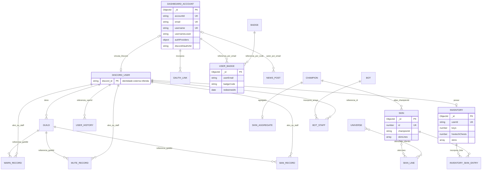

# Engenharia reversa: modelos lógico e relacional

**Data:** 14/10/2026. Reconstrução a partir do MongoDB autorizado, `schema.js`, serviços e consumidores. O MongoDB atual é documental: relações são referências convencionais e não FKs. As propostas abaixo não foram aplicadas ao banco.

## Inventário físico observado

| Coleção real | Documentos | Chave de domínio / vínculo | Observação |
|---|---:|---|---|
| bots | 1 | clientId UNIQUE | Configuração global; arrays de staff/deploy; índice legado em token sem campo observado |
| dashboardaccounts | 5 | accountId UNIQUE; email UNIQUE | username UNIQUE sparse, usernameLower não único; providers embutidos |
| guilds | 7 | guildId UNIQUE | owner é Discord ID; configurações e objetos de gacha embutidos |
| inventories | 9 | userId UNIQUE | **userId é Discord ID**, não accountId nem email; skins é uma lista de IDs numéricos com repetição |
| banlists | 17 | _id | guildId/targetId/staffId sem índice secundário |
| mutelists | 0 | _id | Mesmo schema de punição; tipo dado pelo nome da coleção |
| warnlists | 0 | _id | Mesmo schema de punição |
| userhistories | 0 | _id | Schema declarado; nenhum service atual correspondente encontrado |
| champions | 174 | championId UNIQUE | championId é alias textual, conforme importador (`champInfo.alias`) |
| skins | 173 | championId UNIQUE | Agregados por campeão e raridade; arrays reais declarados como Object |
| skinsidlists | 1.920 | id UNIQUE | Catálogo individual; championId aponta ao alias do campeão |
| skinslines | 218 | id UNIQUE | Grafia física inclui `skinslines`; IDs string |
| universes | 121 | id UNIQUE | skinsSets contém IDs inteiros; relação pretendida com linhas/conjuntos |
| badges | 1 | code UNIQUE | Campanha/medalha e regras de resgate |
| userbadges | 1 | _id | Vínculo por userEmail + badgeCode; não existe UNIQUE composto |
| newsposts | 1 | _id | Autor identificado por email/nome; sem FK |
| apilogs | ~15,1 mil | _id | TTL expiresAt; índices por requestId, nível e rota/data |
| apicaches | 0 | key UNIQUE | TTL expiresAt; payload livre |
| ipratelimits | 0 | (ip,route) UNIQUE | TTL updatedAt de sete dias |

Todos possuem `_id` MongoDB. `__v` é metadado de Mongoose, não identificador de negócio. Model names são pluralizados: `inventory → inventories`, `banlist → banlists`, `skinsIdList → skinsidlists`, `newsPosts → newsposts`. Não existe coleção `punishlists` no snapshot observado, apesar de o scheduler usá-la. A coleção auxiliar `healthcheck` pode ser nomeada pela rota de diagnóstico, mas não foi observada; não representa entidade de negócio.

## Modelo lógico reconstruído do sistema atual

[Abrir diagrama lógico em SVG](modelo-logico.svg) · Fonte Mermaid: [modelos-1.mmd](modelos-1.mmd).

**Leitura correta das cardinalidades:** o diagrama expressa a intenção lógica do código, não constraints já garantidas. `DISCORD_USER`, `OAUTH_LINK`, `INVENTORY_SKIN_ENTRY` e `BOT_STAFF` são identidades externas/subestruturas inferidas, não coleções físicas independentes. Vínculo account–Discord pretende ser 0..1 para cada lado, mas hoje não há UNIQUE que o imponha. Um usuário Discord pode existir sem conta do dashboard; isto explica por que os sete inventários sem vínculo não foram classificados como órfãos.

Universos/linhas são uma relação inferida pelo campo `skinsSets` e pelo domínio do catálogo. A amostra confirma elementos inteiros em `universes.skinsSets` e objetos em `skinsidlists.skinLines`; o payload interno exato e correspondência de todos os IDs precisam ser verificados antes de uma migração. Não se deve simplesmente criar FK de array inteiro para uma coleção.

O sistema não persiste uma lista completa de membership de guilda: as rotas consultam Discord OAuth. Não há relação account–guild armazenada que autorize configurações por si só. Participar de guilda não equivale a administrá-la.

## Domínios e invariantes

| Domínio | Entidades | Regra a preservar |
|---|---|---|
| Identidade | Conta, identidade Discord, vínculo OAuth | accountId estável; provider/ID único; username normalizado único se definido |
| Credenciais | Senha, token OAuth, sessão, ação de credencial | Hashes de senha/tokens de uso único; tokens OAuth cifrados; revogação de sessões |
| Comunidade | Guilda, configuração, canais/cargos externos | Escrita só por gestor autorizado; IDs pertencem à guilda correta |
| Economia | Inventário, recursos, skins, fragmentos, operações | Inteiros não negativos; diária única por janela; prêmio e débito coerentes |
| Catálogo | Campeão, skin, linha, universo | Skin referencia campeão; decompor relações N:N; agregados não são fonte paralela de verdade |
| Moderação | Punição, alvo, staff, tentativa de processamento | Tipo e estado explícitos; expiry e lease não sobrescrevem a data original |
| Conquistas | Badge, redenção | Par usuário/badge único; quota atômica |
| Operação | Log, cache, limitador | TTL não equivale a FK/cascade; métricas distribuídas exigem fonte compartilhada |

## Modelo relacional normalizado proposto

[Abrir diagrama relacional em SVG](modelo-relacional.svg) · Fonte Mermaid: [modelos-2.mmd](modelos-2.mmd).

O [SQL](modelo-relacional.sql) usa PostgreSQL como notação concreta para PK/FK/UNIQUE/CHECK, sem recomendar migração imediata. IDs Discord são texto; não usar Number JavaScript nem converter para número de ponto flutuante. `account_id` permanece texto para preservar IDs antigos que podem não ser UUID; registros novos podem adotar UUID após validar a base existente. IDs de skins são inteiros grandes.

```mermaid
erDiagram
    ACCOUNT ||--o{ OAUTH_IDENTITY : possui
    DISCORD_USER o|--o| OAUTH_IDENTITY : discord
    ACCOUNT ||--o| ACCOUNT_PREFERENCES : configura
    ACCOUNT ||--o| ACCOUNT_CONTACT : dados_opcionais
    ACCOUNT ||--o| ACCOUNT_SECURITY : credenciais
    ACCOUNT ||--o{ AUTH_SESSION : inicia
    ACCOUNT ||--o{ CREDENTIAL_ACTION : solicita
    DISCORD_USER ||--o{ GUILD : dono
    GUILD ||--|| GUILD_SETTINGS : configura
    GUILD ||--o{ GUILD_COMMAND_POLICY : controla
    GUILD ||--o{ AUTO_MESSAGE : agenda
    GUILD ||--o{ GUILD_USER_BLOCK : bloqueia
    GUILD ||--o{ GUILD_ROLE_BLOCK : bloqueia
    GUILD ||--o{ GUILD_CHANNEL_BLOCK : bloqueia
    GUILD ||--o{ GUILD_ROLL_STATE : controla
    DISCORD_USER ||--o| INVENTORY : possui
    INVENTORY ||--o{ INVENTORY_RESOURCE : saldo
    INVENTORY ||--o{ INVENTORY_SKIN : possui
    SKIN ||--o{ INVENTORY_SKIN : quantidade
    INVENTORY ||--o{ INVENTORY_CHAMPION : possui
    CHAMPION ||--o{ INVENTORY_CHAMPION : referencia
    CHAMPION ||--o{ SKIN : possui
    SKIN ||--o{ SKIN_LINE_MEMBER : integra
    SKIN_LINE ||--o{ SKIN_LINE_MEMBER : contem
    UNIVERSE ||--o{ UNIVERSE_LINE : agrupa
    SKIN_LINE ||--o{ UNIVERSE_LINE : participa
    ACCOUNT ||--o{ BADGE_REDEMPTION : resgata
    BADGE ||--o{ BADGE_REDEMPTION : concede
    GUILD ||--o{ PUNISHMENT : registra
    DISCORD_USER ||--o{ PUNISHMENT : alvo_ou_staff
    ACCOUNT o|--o{ NEWS_POST : publica
    INVENTORY ||--o{ ECONOMY_OPERATION : registra
    BOT ||--o{ BOT_STAFF : equipe
    DISCORD_USER ||--o{ BOT_STAFF : participa
```

Essas relações cobrem os domínios principais; tabelas operacionais, recursos Discord e materializações auxiliares estão descritos no SQL. Existem campos JSONB intencionais para contexto de eventos e dados legados de estrutura não observada; eles não escondem os vínculos principais. Não é promessa de eliminação de todo JSON ou de normalização completa de payloads cuja semântica não pôde ser demonstrada.

### Transformações do modelo atual

| Origem | Destino | Transformação |
|---|---|---|
| dashboardaccounts.accountId | account.account_id | Preservar identidade; `_id` em legacy_mongo_id para rastreio |
| authProviders + campos Discord legados | oauth_identity | Uma linha por conta/provider; conferir divergências entre os dois registros de identidade antes de escolher valor |
| passwords / 2FA / reset | account_security, mfa_backup_code, credential_action | Separar credenciais; transformar backup/reset em hashes e validade; não importar token antigo inseguro automaticamente |
| preferências / contato / bloqueio / fechamento | account_preferences, account_contact, account, account_security | Decompor domínios; dados de contato continuam opcionais e devem ser minimizados |
| inventários.userId | discord_user + inventory | Não vincular diretamente a UUID de conta; criar identidade Discord mesmo sem dashboard |
| skins[] | inventory_skin | Agrupar ocorrências em quantidade ou preservar cada aquisição em ledger; 397 entradas inteiras no snapshot não significam 397 skins únicas |
| keys / baús / essências | inventory_resource | Código de recurso + quantidade; preservar grafia de origem `mythicEssece` no mapeamento, corrigindo destino para `mythicEssence` |
| championShards / champions / skinShards | inventory_champion / inventory_skin_shard | Confirmar estrutura/quantidades dos objetos antes de decompor; nunca inferir quantidade de objeto vazio |
| guilds config escalar | guild_settings | Declarar campos ausentes e manter unidades em ms; vazio de ID vira NULL |
| blockedChannels / novos bloqueios | guild_channel_block / guild_user_block / guild_role_block | Separar tipos; reconciliar IDs misturados pelo frontend antes de migrar |
| gachaRolls / usersInventory | guild_roll_state / guild_inventory_legacy | Estado de roll por usuário se shape confirmado; snapshot legado retido para não perder mapa não observado |
| banlists / mutelists / warnlists | punishment | Unificar preservando tipo, documento original, datas e autoria; status/lease novos |
| userhistories | user_history | Preservar payload legado; vazio atualmente, sem inferir histórico ausente |
| skinsidlists | skin | Fonte principal; championId é alias, não número Riot |
| skins agregado | VIEW skin_aggregate + legado opcional | Derivar contagens do catálogo; reconciliar classificação legacy/rarity antes de remover agregados |
| skinLines[] / skinsSets[] | skin_line_member / universe_line | Extração e conversão dos IDs com verificação de correspondência; relação de universo ainda inferida |
| userbadges.userEmail/badgeCode | badge_redemption.account_id/badge_id | Resolver vínculos atuais e usar IDs estáveis; UNIQUE composto |
| bots arrays de staff/deploy | bot_staff / bot_staff_permission / bot_deploy_guild | Decompor e guardar segredo fora de configuração pública |
| logs / cache / rate limit | api_log / api_cache / ip_rate_limit | PostgreSQL não possui TTL nativo equivalente: agendar limpeza; campos de contexto sem valores pessoais em documentação |

### Constraints e consultas importantes

- Username: UNIQUE parcial em `lower(username)` não vazio; aplicação deve manter cooldown/sintaxe e reservar handles.
- OAuth: UNIQUE `(provider,provider_user_id)` e `(account_id,provider)`. Contas desvinculadas não devem bloquear nova conta indevidamente; definir política de retenção.
- Badge: UNIQUE `(account_id,badge_id)`; quota precisa de transação/lock/contador condicional além do índice.
- Inventário: PK por identidade Discord; saldos/quantidades com CHECK `>=0`; diária precisa de escrita condicional/idempotência além do schema.
- Punição: índice de jobs por status/data; `expires_at` separado de `lease_until`; retry não deve mudar o fim original da punição.
- Canais/cargos: chaves compostas com guild_id para impedir referência a recurso de outro servidor.
- Notícias: índice `(pinned DESC,published_at DESC)`; autoria por ID estável, snapshot público do nome se desejado.
- Logs: índices existentes fazem sentido; avaliar indexação de eventos administrativos pelo ator e guilda conforme consultas reais, medindo custo de escrita.
- Arrays de inventário, gacha e históricos hoje não têm tamanho limitado pelo schema; paginação e coleções/tabelas de detalhe evitam crescimento do documento único.

## Consistência observada e limitações de dados

Nenhuma duplicata de username normalizado, provider Discord ou par de badge foi encontrada. Todas as skins individuais e agregados consultados referenciam campeões existentes. Não foram observados saldos negativos. Isto descreve os dados no momento da leitura e não demonstra resistência a concorrência.

Dois usuários não tinham handle; sete inventários não tinham conta vinculada ao dashboard. `browserFingerprint`, declarado Object com default string, apareceu como string nos cinco registros. Arrays de raridade em `skins` apareceram como arrays, embora declarados Object. A ausência de subdocumentos tipados reduz a capacidade de provar dependências e normalizar automaticamente.

O índice `token_1` em bots existe sem campo token observado; índices não são removidos automaticamente quando um campo sai do schema. Não remover índices legados sem revisar histórico, uso e plano de migração.

## Plano para eventual migração ou saneamento

1. Backup e restauração em staging; registrar contagens/hash de dados apropriados e não exportar credenciais sem proteção.
2. Validar formatos de accountId, alias de campeão, IDs Discord, campos Mixed e relação universo/linha. Reconciliar identidades legadas/provider.
3. Deduplicar pares e handles e classificar bloqueios; criar identities Discord para usuários exclusivos do bot. Definir retenção e closure antes de cascades.
4. Criar constraints/índices em migração versionada; não depender de timers silenciosos no boot. Planejar lock e duração da criação de índices.
5. Transformar arrays em relações sem perder multiplicidade; reconciliar totais por recurso/usuário/raridade e amostras de catálogo.
6. Testar concorrência, rollback, autorização por guilda, exclusão e recuperação de backup. Código e dados devem compartilhar versão de contrato.
7. Cutover com janela e plano de rollback explícitos. A proposta SQL entregue é documentação de arquitetura; exige ETL e teste antes de ser usada em produção.

O [dicionário](DICIONARIO-DADOS.md) preserva todos os 302 campos declarados para que a eventual migração não seja baseada somente nos campos resumidos nos diagramas.
