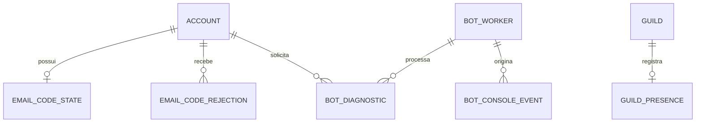

# Adendo aos modelos lógico e relacional

Complementa o [levantamento de 14/10](../auditoria-2026-10-14/MODELOS.md), sem substituir o retrato histórico do MongoDB. Os elementos abaixo foram declarados no código da branch; **não foram aplicados como migração SQL nem conferidos como coleções de produção em 24/10**.

## Modelo lógico

| Entidade | Identidade e relacionamento | Restrições e ciclo de vida |
|---|---|---|
| Estado de código | Um registro por `accountId`; conta tem zero ou um estado. | `purpose` verify/reset; HMAC do código, versão da credencial, validade, tentativas e bloqueio compartilhado. Novo pedido substitui o código. Validade de 15 min; bloqueio de 24 h; limpeza técnica após dois dias. |
| Recusa de código | Várias recusas por conta; hash do token único. | Cada email possui link próprio válido por 24 h. Consumo único em transação; permite invalidar um código posterior da mesma conta. |
| Revogação de sessão | Hash do JWT, sem armazenamento do JWT original. | Consulta até sua expiração; índice único e TTL. A conta também possui versão de sessão. |
| Transação OAuth | Hash único do nonce do navegador. | Uso único; validade de dez minutos. Origem e intenção são protegidas no state assinado. |
| Troca OAuth | Hash único do código; origem e hash do vínculo com navegador. | Sessão criptografada no servidor; validade de 60 s; consumo único vinculado a origem e cookie. |
| Evento do console | `eventId` UUID único, origem `workerId`; `_id` Mongo serve de cursor de ingestão. | Mensagem limitada, nível validado, data de ocorrência e de ingestão separadas; leitura/limpeza de 24 h. |
| Processo do bot | `workerId` UUID por execução; `botId` Discord. | Sinal de atividade e medidas reais do processo; sinal ativo por 45 s, registro temporário de 24 h. A relação com eventos é histórica e não exige que o worker continue ativo. |
| Diagnóstico do bot | UUID de pedido único, conta solicitante e comando permitido. | Prazo de dois minutos; lease de 45 s com token exclusivo; estados pending/running/completed/failed. A leitura apresenta expired depois do prazo. Retenção de 24 h. |
| Presença do bot na guilda | Embutida no documento `guilds`, sem criar coleção separada. | `botPresent` e `lastSyncedAt`; reconciliação altera metadados, não regras. Saída preserva configuração. |

No MongoDB, as referências acima são campos e regras da aplicação; não são chaves estrangeiras executadas pelo banco. Índices únicos/TTL estão em `lumina-api/src/database/indexes.js`; a migração é explícita em produção.

## Localização aproximada de conta

O documento `dashboardaccounts` preserva o conjunto `registrationIp/UserAgent/Location/Country/City/Region/LocationSource` no cadastro e substitui apenas `lastLogin` e o conjunto equivalente `lastLogin*` em cada autenticação bem-sucedida. `Location` é a apresentação derivada de cidade, região e país, não uma cadeia de IPs. `LocationSource` é `cloudflare` ou `unavailable`. Cadastro com senha não cria um falso último login; o campo fica nulo até a primeira autenticação. Cadastro OAuth já estabelece sessão e grava ambos os conjuntos.

São dados privados de segurança, excluídos do DTO comum de conta e de perfis públicos. Não armazenamos coordenadas, CEP ou um histórico de deslocamentos. Contas históricas sem localização não recebem dados inferidos a partir de acessos posteriores. A proposta SQL adiciona `account_access_snapshot`, com até duas linhas por conta e FK com exclusão em cascata; a imutabilidade do registro inicial e a substituição da linha de último login devem ser garantidas pela aplicação.

A implementação confere o IP do proxy na lista oficial de redes Cloudflare. Na Vercel, usa o cabeçalho de peer sobrescrito pela plataforma; fora dela, verifica o peer TCP. Cabeçalhos `cf-*` de uma conexão direta não estabelecem confiança. As faixas públicas estão versionadas em `src/config/cloudflareNetworks.json` e precisam de revisão quando a Cloudflare alterar a lista.

## Proposta relacional complementar

[adendo-relacional.sql](adendo-relacional.sql) usa a tabela `account` e a tabela `guild` da proposta original. Inclui PK, FK, UNIQUE, CHECK e índices de consulta; não depende de inferir IDs de conta como UUID, pois os IDs atuais são texto.

SQL não oferece a mesma limpeza automática dos índices TTL do MongoDB: uma implantação PostgreSQL precisaria de job de expiração, armazenamento dos hashes/credenciais com os mesmos controles e transações equivalentes. O script é documentação de normalização, não uma migração do banco em uso.

Validação de 24/10: sintaxe aprovada pelo parser PostgreSQL `pglast 8.7`; os destinos de referências são confrontados com a proposta histórica. Nenhum banco PostgreSQL foi criado ou alterado. O adendo seleciona explicitamente o schema `lumina_model`, porque o `SET LOCAL` do script original termina no `COMMIT`.
